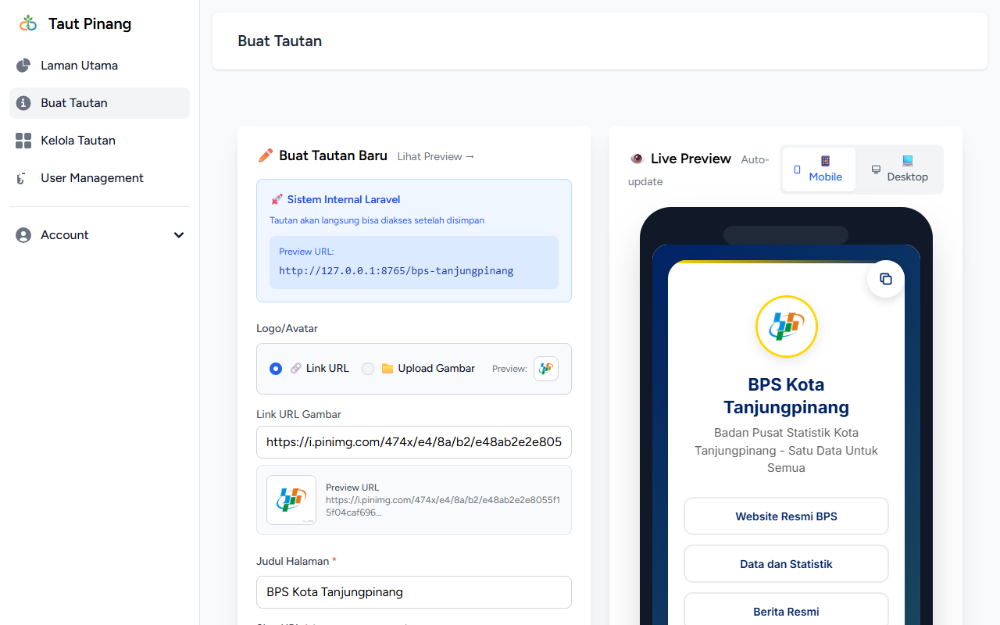
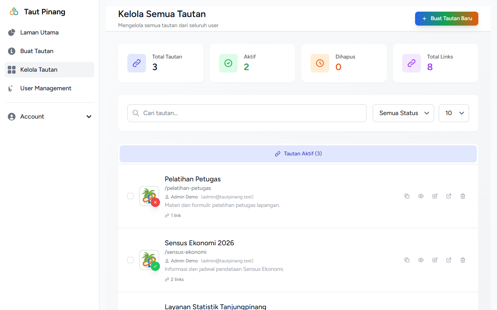
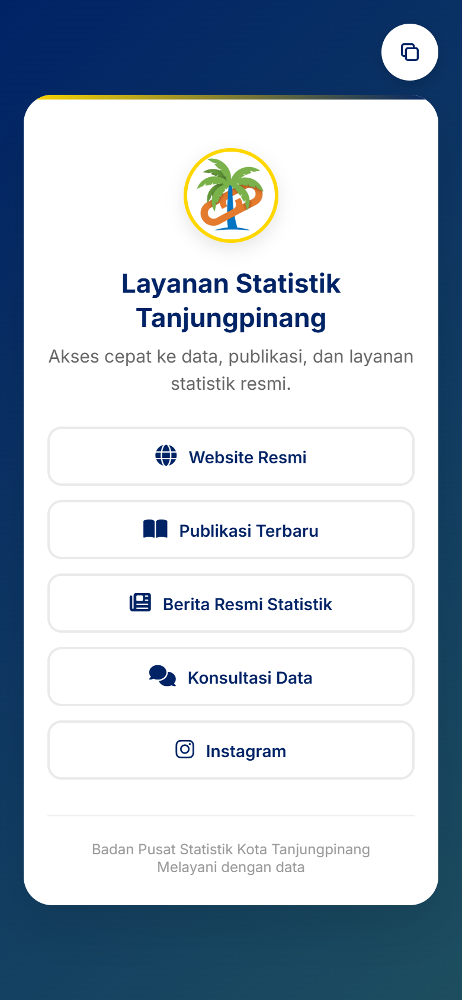
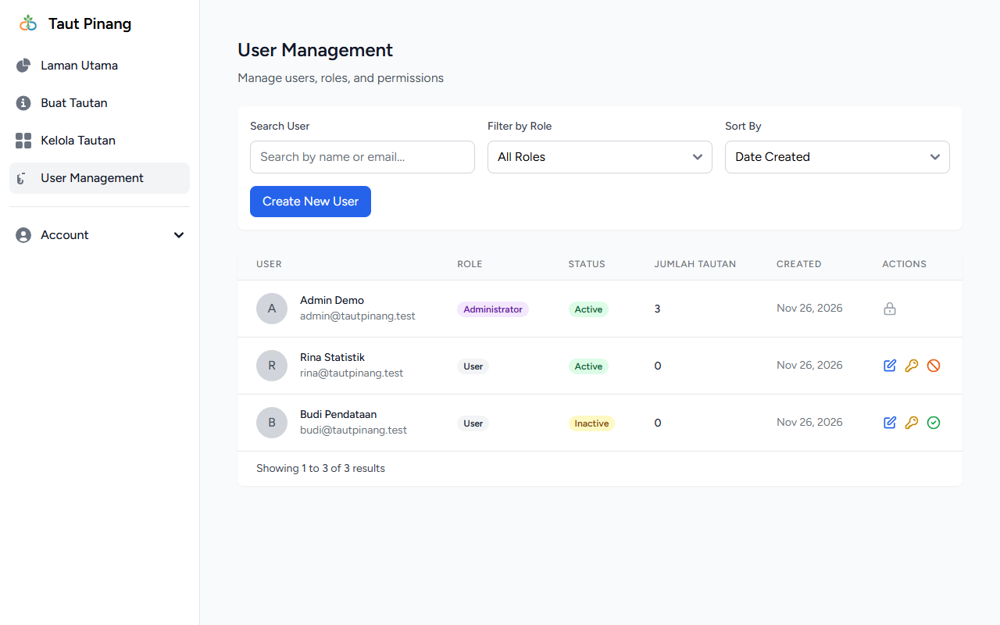
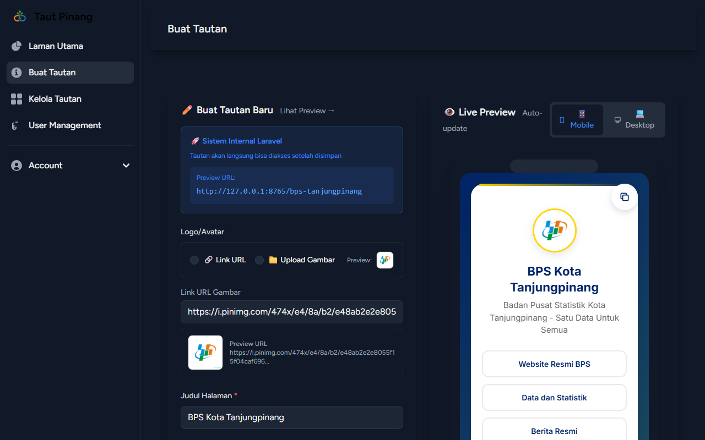
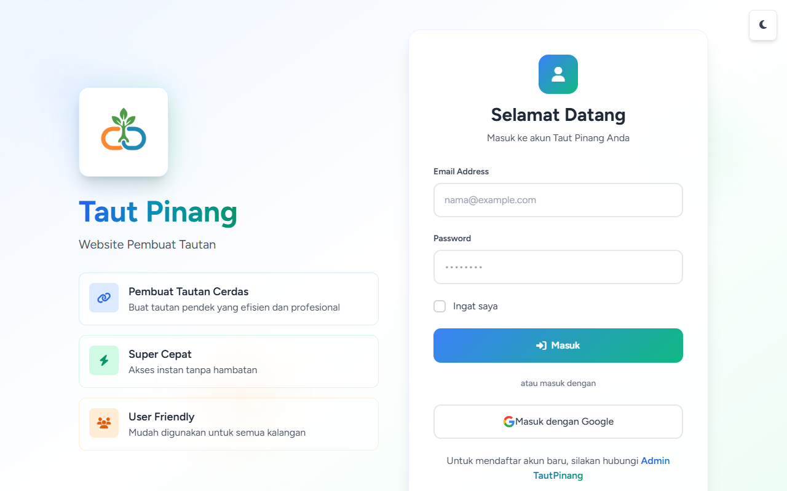
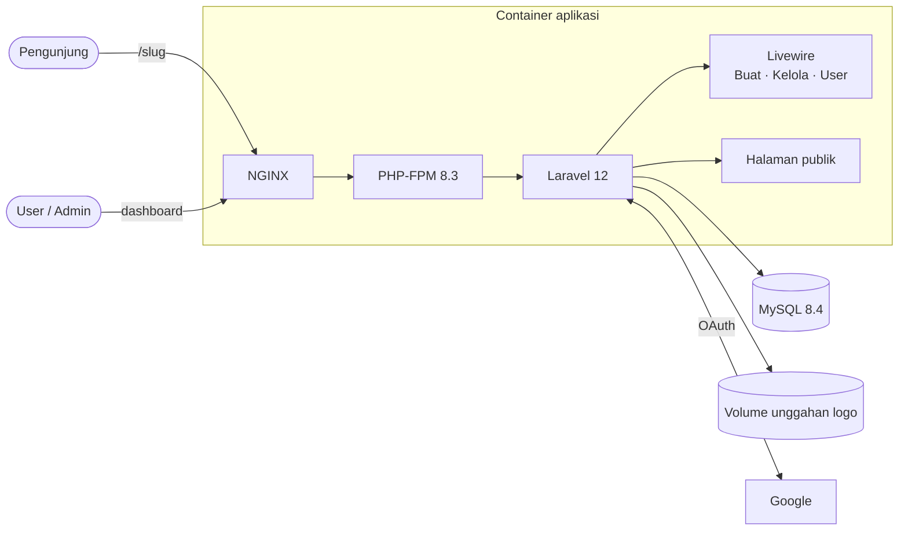

<a id="readme-top"></a>

<div align="center">


# TautPinang

**Satu halaman, banyak tautan: rapi, cepat, dan mudah dibagikan.**

Aplikasi web untuk membuat dan mengelola halaman kumpulan tautan (*link-in-bio*)
lengkap dengan QR code, gaya tampilan yang bisa diatur, dan panel admin.

[](https://github.com/albertassidiq/TautPinang/actions/workflows/php-runtime.yml)


[Fitur](#-fitur) · [Tampilan](#-tampilan) · [Tech Stack](#-tech-stack) · [Mulai Cepat](#-mulai-cepat) · [Keamanan](#-keamanan)

<br>



</div>

<br>

<details>
<summary><strong>Daftar isi</strong></summary>

- [Tentang](#-tentang)
- [Fitur](#-fitur)
- [Tampilan](#-tampilan)
- [Tech Stack](#-tech-stack)
- [Arsitektur](#-arsitektur)
- [Mulai Cepat](#-mulai-cepat)
- [Konfigurasi](#-konfigurasi)
- [Struktur Proyek](#-struktur-proyek)
- [Pengujian & CI](#-pengujian--ci)
- [Keamanan](#-keamanan)

</details>

## 📌 Tentang

TautPinang mengumpulkan banyak tautan penting ke dalam satu halaman dengan
alamat yang mudah diingat, misalnya `https://domain-anda/layanan-statistik`.
Halaman bisa dibuat tanpa menulis kode, langsung terlihat hasilnya lewat
*live preview*, dan bisa dibagikan sebagai tautan atau QR code.

<table>
  <tr>
    <td width="33%" valign="top">
      <h3>🎨 Desain tanpa kode</h3>
      Atur logo, warna, tombol, efek hover, icon, dan QR code, lalu lihat hasilnya seketika.
    </td>
    <td width="33%" valign="top">
      <h3>🗂️ Kelola dengan mudah</h3>
      Cari, filter, duplikat, aksi massal, impor/ekspor JSON, dan pemulihan data terhapus.
    </td>
    <td width="33%" valign="top">
      <h3>🔐 Aman untuk tim</h3>
      Peran admin dan user, login Google, 2FA, dan akun nonaktif otomatis menonaktifkan halamannya.
    </td>
  </tr>
</table>

<p align="right">(<a href="#readme-top">kembali ke atas</a>)</p>

## ✨ Fitur

### Pembuat tautan

| Fitur | Keterangan |
| --- | --- |
| **Live preview** | Tampilan halaman diperbarui seketika saat form diubah, dalam mode mobile atau desktop. |
| **Identitas halaman** | Judul, deskripsi, dan *slug* unik yang menjadi alamat publik. |
| **Logo** | Dari URL atau unggah gambar (klik atau *drag & drop*, maks. 2 MB). |
| **Daftar tautan** | Tambah, hapus, urutkan dengan *drag & drop*, dan aktif/nonaktifkan per tautan. |
| **Icon** | Pilih icon Font Awesome untuk tiap tautan lewat icon picker. |
| **Gaya tombol** | Warna latar, teks, dan border; radius; efek hover (gradien dan *glow*); warna RGBA; warna khusus per tautan. |
| **QR code** | Atur posisi, ukuran, warna, border, dan transparansi QR code halaman. |
| **Footer dan editor JSON** | Dua baris footer, plus editor gaya JSON untuk mengatur seluruh gaya sekaligus. |
| **Unduh HTML** | Ekspor halaman sebagai file `.html` statis. |

### Halaman publik

- Bisa diakses tanpa login di `/{slug}`, nyaman dibuka di ponsel.
- Meta tag Open Graph untuk pratinjau saat dibagikan ke media sosial.
- Tautan nonaktif disembunyikan. Halaman nonaktif, halaman milik akun nonaktif,
  atau slug yang tidak ada menampilkan halaman 404 khusus.

### Kelola tautan

- Cari, filter (status, jenis logo), dan urutkan; statistik total, aktif, terhapus, dan jumlah tautan.
- Lihat detail, edit, **duplikat**, serta aktifkan/nonaktifkan halaman.
- **Aksi massal**: aktifkan, nonaktifkan, atau hapus beberapa halaman sekaligus.
- **Impor dan ekspor** data dalam format JSON.
- **Riwayat terhapus**: pulihkan halaman atau hapus permanen, satu per satu maupun massal.

### Akun dan admin

- Registrasi, login email/password, dan **login dengan Google**.
- Autentikasi dua faktor (2FA), kelola profil, password, dan sesi browser.
- **Manajemen user** (admin): tambah, edit, ubah role, reset password, aktifkan/nonaktifkan akun.
- **Mode gelap** di seluruh halaman utama.

| Kemampuan | User | Admin |
| --- | :---: | :---: |
| Membuat, mengedit, dan menghapus halaman milik sendiri | ✅ | ✅ |
| Melihat dan mengaktifkan/menonaktifkan halaman semua pengguna | — | ✅ |
| Manajemen user dan role | — | ✅ |

> [!NOTE]
> Hanya pembuat halaman yang dapat mengubah isinya. Halaman milik akun yang
> dinonaktifkan langsung tidak dapat diakses publik sampai akunnya aktif kembali.

<p align="right">(<a href="#readme-top">kembali ke atas</a>)</p>

## 📸 Tampilan

<table>
  <tr>
    <td width="68%" align="center"><br><sub><b>Kelola Tautan</b>: statistik, pencarian, dan aksi cepat</sub></td>
    <td width="32%" align="center" rowspan="2"><br><sub><b>Halaman publik</b> di ponsel</sub></td>
  </tr>
  <tr>
    <td align="center"><br><sub><b>User Management</b>: role dan status akun</sub></td>
  </tr>
  <tr>
    <td align="center"><br><sub><b>Mode gelap</b></sub></td>
    <td align="center"><br><sub><b>Login</b> dengan email atau Google</sub></td>
  </tr>
</table>

<p align="right">(<a href="#readme-top">kembali ke atas</a>)</p>

## 🧰 Tech Stack

<p align="center">
  <a href="https://skillicons.dev"></a>
</p>

| Lapisan | Teknologi |
| --- | --- |
| Backend | PHP 8.3.37, Laravel 12, Livewire 3 |
| Autentikasi | Jetstream 5 (Fortify, Sanctum), Laravel Socialite (Google OAuth) |
| Frontend | Tailwind CSS 3, Alpine.js, Vite, Font Awesome |
| Database | MySQL 8.4 (produksi), SQLite (pengujian) |
| Infrastruktur | Docker (`serversideup/php`: NGINX + PHP-FPM), GitHub Actions |

<p align="right">(<a href="#readme-top">kembali ke atas</a>)</p>

## 🏗️ Arsitektur



<p align="right">(<a href="#readme-top">kembali ke atas</a>)</p>

## 🚀 Mulai Cepat

### Dengan Docker (disarankan)

```sh
cp .env.docker.example .env.docker   # isi APP_KEY, DB_PASSWORD, DB_ROOT_PASSWORD, Google OAuth
docker compose --env-file .env.docker build --pull
docker compose --env-file .env.docker up -d --wait
docker compose --env-file .env.docker exec app php artisan migrate --force
```

Buka `http://localhost:8080`. Panduan lengkap, termasuk pembaruan tanpa
kehilangan data, ada di [docs/docker.md](docs/docker.md).

<details>
<summary><strong>Tanpa Docker</strong></summary>

<br>

Butuh PHP **8.3.37 atau lebih baru di cabang 8.3**, Composer, Node.js, dan MySQL.

```sh
composer install
npm ci
cp .env.example .env          # atur koneksi database
php artisan key:generate
php artisan migrate
php artisan storage:link      # agar logo unggahan bisa diakses
npm run build                 # atau `npm run dev` saat pengembangan
php artisan serve
```

</details>

### Membuat admin pertama

Pengguna baru selalu ber-role `user`. Daftar lewat `/register`, lalu jadikan admin:

```sh
php artisan tinker --execute="App\Models\User::where('email', 'email@anda')->update(['role' => 'admin']);"
```

Di Docker, awali dengan `docker compose --env-file .env.docker exec app`.

<p align="right">(<a href="#readme-top">kembali ke atas</a>)</p>

## ⚙️ Konfigurasi

| Variabel | Keterangan |
| --- | --- |
| `APP_URL` | URL publik aplikasi, dipakai untuk tautan dan QR code |
| `APP_ENV`, `APP_DEBUG` | Gunakan `production` dan `false` di server |
| `DB_*` | Koneksi MySQL |
| `GOOGLE_CLIENT_ID`, `GOOGLE_CLIENT_SECRET` | Kredensial OAuth dari Google Cloud Console |
| `GOOGLE_REDIRECT_URI` | `APP_URL` + `/auth/google/callback` |

<details>
<summary><strong>Daftar halaman aplikasi</strong></summary>

<br>

| URL | Keterangan | Akses |
| --- | --- | --- |
| `/login`, `/register` | Masuk dan daftar | Publik |
| `/auth/google` | Login dengan Google | Publik |
| `/dashboard` | Ringkasan | Login |
| `/buat-tautan` | Membuat halaman tautan | Login |
| `/kelola-tautan` | Daftar dan pengelolaan halaman | Login |
| `/edit-tautan/{id}` | Mengedit halaman milik sendiri | Login |
| `/user/profile` | Profil, password, 2FA, sesi | Login |
| `/user-management` | Manajemen user | Admin |
| `/{slug}` | Halaman tautan publik | Publik |

</details>

<p align="right">(<a href="#readme-top">kembali ke atas</a>)</p>

## 📁 Struktur Proyek

```text
app/
├── Http/Controllers/      # Halaman publik, Google OAuth
├── Http/Livewire/         # BuatTautan, EditTautan, KelolaTautan, UserManagement, Dashboard
├── Http/Middleware/       # Role, status akun, status tautan
└── Models/                # Tautan, User
resources/views/           # Blade + Livewire views (termasuk tautan/public.blade.php)
database/migrations/       # Skema users dan tautans
tests/Feature/             # Tes fitur (Livewire, akses, keamanan)
docker/ · Dockerfile · compose.yaml
docs/                      # Panduan Docker, catatan keamanan, screenshot
```

<p align="right">(<a href="#readme-top">kembali ke atas</a>)</p>

## 🧪 Pengujian & CI

```sh
php vendor/bin/phpunit
```

Atau dengan runtime yang sama seperti produksi:

```sh
docker build --pull --target testing -t tautpinang:tests .
docker run --rm --entrypoint php tautpinang:tests vendor/bin/phpunit --colors=never --fail-on-warning
```

Setiap push dicek oleh workflow
[PHP runtime security](.github/workflows/php-runtime.yml):

| Tahap | Pemeriksaan |
| --- | --- |
| Dependensi | `composer audit`, `composer validate`, platform requirement |
| Tes | Suite PHPUnit lengkap |
| Image | Build produksi, versi PHP CLI dan FPM, `session.upload_progress` mati |
| Integrasi | Migrasi MySQL, smoke test login lewat NGINX/PHP-FPM, volume unggahan bertahan |

Hasil terakhir (26 November 2026): **47 test, 40 lulus, 7 dilewati, 0 gagal**;
audit Composer **0 advisori**.

<p align="right">(<a href="#readme-top">kembali ke atas</a>)</p>

## 🛡️ Keamanan

| Tanggal | Pembaruan |
| --- | --- |
| 26 Nov 2026 | PHP **8.3.37** (15 CVE, termasuk request smuggling PHP-FPM dan RCE via session/timezone); Laravel 12.74.0 dan Symfony 7.4.24 (20 advisori Composer); perbaikan stored XSS pada icon; halaman akun nonaktif disembunyikan |
| 23 Okt 2026 | PHP **8.3.36** untuk CVE-2026-109618 dan CVE-2026-109619 (RCE tanpa autentikasi); pembaruan seluruh dependensi |

> [!IMPORTANT]
> Push kode tidak memperbarui server. Image harus dibangun ulang dan semua
> container/worker lama harus diganti. Panduan rebuild, verifikasi PHP-FPM, dan
> daftar CVE lengkap ada di [docs/php-security-update.md](docs/php-security-update.md).

<p align="right">(<a href="#readme-top">kembali ke atas</a>)</p>

---

<div align="center">
  <br>
  <sub>Dikembangkan oleh <a href="https://github.com/albertassidiq">@albertassidiq</a> · Dibuat di Tanjungpinang</sub>
</div>
